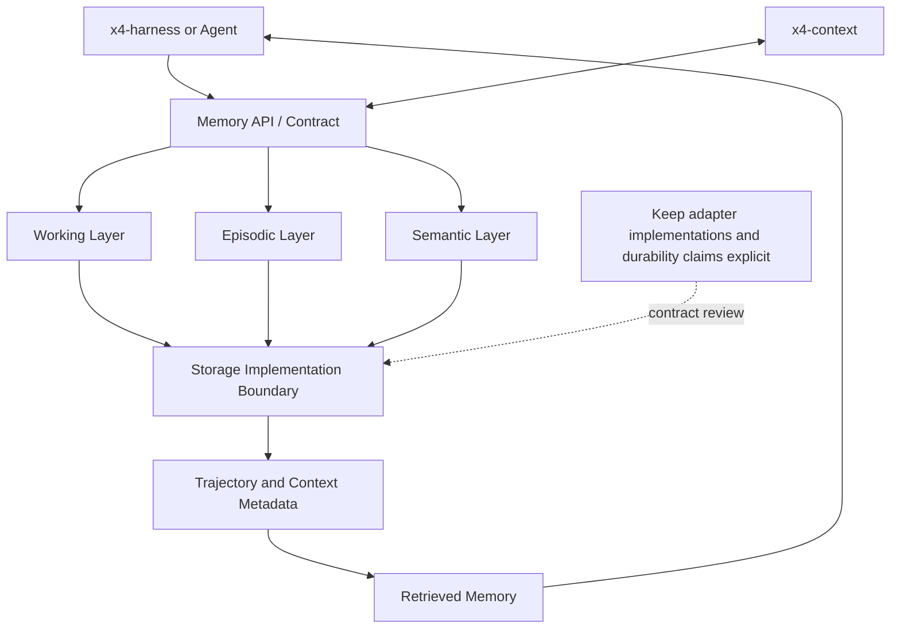

# x4-memory-core

**Multi-layer persistent agent memory**: working, episodic, semantic. Trajectory learning and long-term context for autonomous agents.

Integrates with x4-context and x4-harness.

## Layers

| Layer | Lifetime | Purpose |
|-------|----------|---------|
| Working | Single turn / short session | Active tokens |
| Episodic | Project / task lifetime | Trajectory of actions + outcomes |
| Semantic | Long-term | Distilled facts and skills |

<!-- X4-APEX-DIAGRAM-START:x4-memory-core -->



<!-- X4-APEX-DIAGRAM-END:x4-memory-core -->

## Quick Start

```bash
pip install -e ".[dev]"
python -m x4_memory_core.demo
```

## License

Apache-2.0
